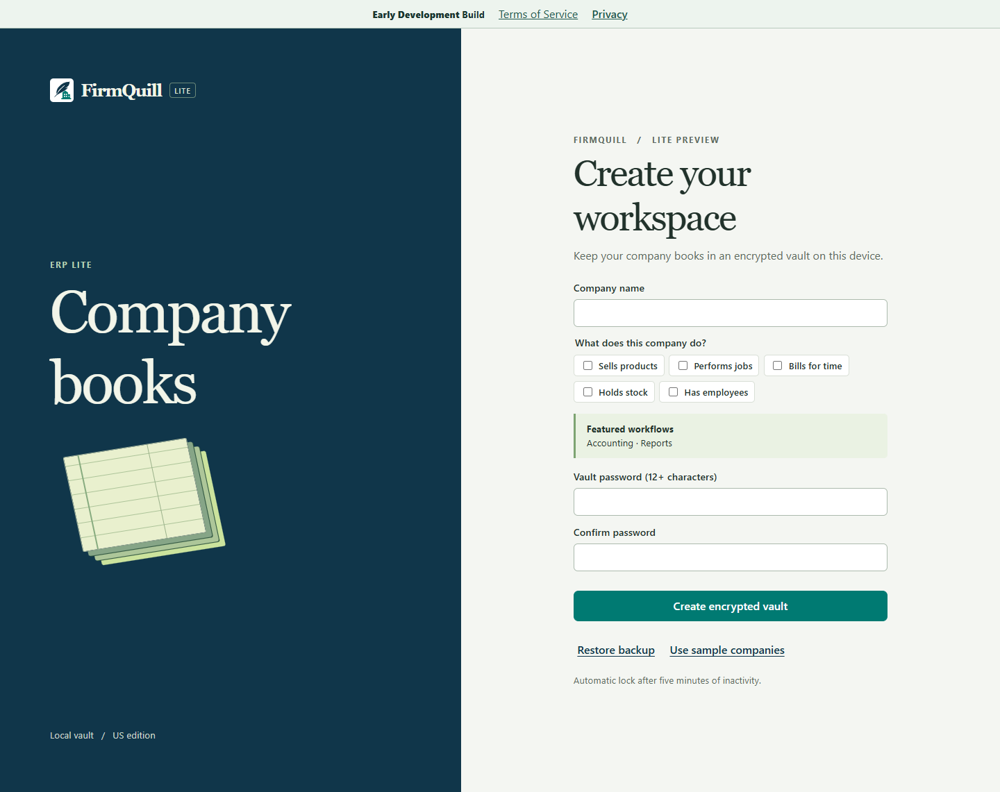

# FQ-Lite

Version **0.5.0-preview.1** · one owner, encrypted browser vault · Windows / Node 24

Download or copy the complete application folder. Keep an encrypted backup before replacing application files. To preserve an existing browser workspace, keep the same browser profile, protocol, hostname, port and application path. A different address opens separate browser storage; restore your encrypted backup there if needed.

1. Open a terminal in this folder and run `node serve.mjs`.
2. Open `http://127.0.0.1:4178/` in Edge or Chrome. Review the Terms of Service and choose **I agree** to continue.
3. For existing books, unlock with the current vault password. For new books, enter a company name and a password of at least 12 characters, or choose **Restore backup**.
4. After opening the workspace, use **Company setup → Download backup** and keep the encrypted file and password separately. The local server serves application files; business records remain in the browser's encrypted vault.

Keep the terminal open while using the local app. The service worker supports offline use after the application assets have loaded successfully. Update and reopen at the same address to receive new application assets. New owner desk records are added only when you first save a workflow; opening an older vault does not rewrite its financial records or identifiers. If a save reports that another session changed the vault, unlock or reload and review the current records before trying again.

See [multi-line commercial documents](COMMERCE-LINES.md) for partial shipments and receipts, discounts and returns.

This edition has one operator and no employee or shared platform accounts. The complete versioned customer manual, workflow screenshots and support index are delivered through the separate private knowledge base. They are excluded from this public application repository. The built-in federal worksheet remains a preview. **Payroll → Manual payroll** supports finalizing runs using owner-entered rules; neither mode submits forms or transfers money.

## Manual payroll
Open **Jobs & time** to add employees, then **Payroll** to add company rules, optionally seed opening taxable wages for a rule and employee, and save a draft pay run. Rules can be percentage, flat or progressive per-period brackets. Use the same stable rule code for a later effective-date version; optionally restrict its work state/locality, taxable wages per period or taxable wages per calendar year. Withholding starts from entered gross wages. No statutory defaults, overtime calculation, pre-tax benefits, filings or payment instructions are inferred.

Review gross, employee withholding, net and employer tax before finalizing. The run retains its original rule versions and prior taxable bases. It appears in the encrypted vault, downloads as a PDF statement and can be exported in the payroll register. The optional balanced journal worksheet takes independently verified external account codes and does not post to FirmQuill. Enter finalized runs in chronological pay-date order; overlapping periods, duplicate runs and editing a finalized run are not supported. Use a separate documented adjustment process if needed. Backups include payroll records as sensitive data.

## Code license and official terms

First-party JavaScript/module, HTML markup, CSS and build/test script code in this repository is covered. See [LICENSE](LICENSE) for the standard MIT grant ([upstream text](https://opensource.org/license/mit)). Names, logos, other branding, artwork, screenshots, user records, third-party material, legal documents (terms, privacy text and license/notice texts), and substantive legal text embedded in source are excluded from this code grant. No third-party rights are claimed. Separate component licenses and notices remain applicable.

Acceptance applies to this official build or service. It does not limit rights granted by the MIT source-code license or any separate component license. The official agreement remains separate and is available from the app’s Terms of Service control. See THIRD-PARTY-NOTICES.md for the shipping audit.

### Employer-entered Manual Payroll

Manual payroll runs offline without activation. Define your own jurisdiction
labels, distinct rule codes, wage bases, payer, deduction treatment, cent
rounding and partial-period policy. A label never selects a rate by itself.
Enter real earnings and any applicable deduction amounts for the actual period.
The application neither prorates nor annualizes them. No tax tables, filings or
payments are included in this workflow. The legacy federal estimator is separate
and does not supply Manual Payroll. Existing finalized records are not rewritten.
Use a similarly updated Full Suite before transferring new versioned snapshots;
earlier builds may reject them. The payroll register includes the reviewed rule
settings, and the journal worksheet remains a separate manual export.
